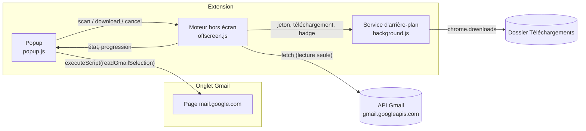
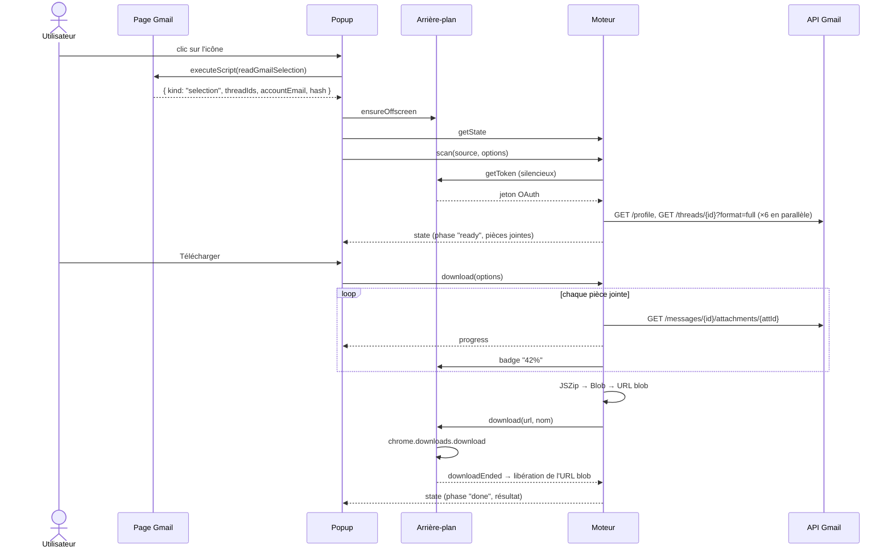
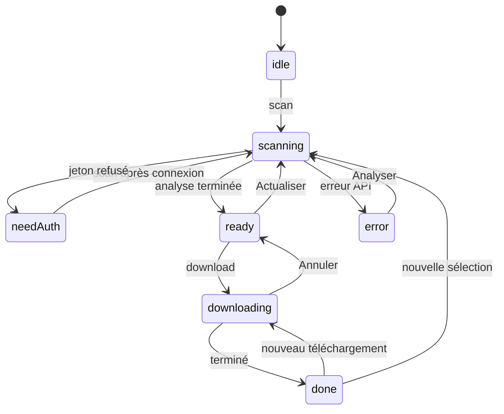

# Architecture

Extension Chrome Manifest V3 (MV3), la version actuelle du format des extensions Chrome : service d'arrière-plan à la demande, pas de code chargé depuis Internet.

## Vue d'ensemble

Trois contextes de l'extension, chacun avec un rôle précis :

| Composant | Fichiers | Durée de vie | Rôle |
| --- | --- | --- | --- |
| Popup | `popup.html`, `popup.css`, `popup.js` | Tant qu'elle est ouverte ; se ferme dès qu'elle perd le focus | Lit la sélection de l'onglet Gmail, affiche l'état du moteur, transmet les actions de l'utilisateur |
| Moteur hors écran | `offscreen.html`, `offscreen.js` | Créé à la première ouverture de la popup, reste ouvert ensuite | Appels à l'API Gmail, liste des pièces jointes, construction des ZIP ; garde l'état entre deux ouvertures de la popup |
| Service d'arrière-plan | `background.js` | Démarré par Chrome à chaque message, arrêté après inactivité | Jeton OAuth, téléchargements, badge de l'icône, création du moteur |

Document hors écran (« offscreen document ») : page invisible propre à l'extension, créée avec `chrome.offscreen`. Elle sert ici à faire le travail long : la popup s'arrête dès qu'elle se ferme, et le service d'arrière-plan peut être arrêté par Chrome à tout moment. Ce document n'a accès qu'à `chrome.runtime` (messagerie). D'où le relais par le service d'arrière-plan pour `chrome.identity` (jeton) et `chrome.downloads` (enregistrement des fichiers).

Code partagé : `lib/gmail.js` (client API et fonctions pures, testables avec Node) et `lib/jszip.min.js` (JSZip 3.10.1, licence MIT, copié dans le dépôt car MV3 interdit le code distant).

## Déroulement type : e-mails cochés

## Lecture de la page Gmail

`readGmailSelection()` (`lib/gmail.js`) est injectée dans l'onglet Gmail par `chrome.scripting.executeScript`. Chrome sérialise la fonction : elle doit rester autonome, sans référence à une variable ou fonction extérieure.

Repères du DOM de Gmail, relevés sur l'interface réelle :

| Repère | Signification |
| --- | --- |
| `div[role=main]` visible | Zone principale (Gmail garde d'autres vues masquées dans la page) |
| `tr.zA` | Ligne de la liste des e-mails |
| `[role=checkbox][aria-checked="true"]` (et classe `x7` sur la ligne) | Ligne cochée |
| `[data-legacy-thread-id]` | Identifiant de conversation ; identique au `threadId` de l'API Gmail |
| `div[gh=mtb] [role=checkbox]` | Case générale de la barre d'outils (`true`, `false` ou `mixed`) |
| Texte « Effacer la sélection » / « Clear selection » | Affiché après « Sélectionner les N conversations correspondant à cette recherche » |
| `h2.hP[data-legacy-thread-id]` | Objet d'une conversation ouverte |
| `document.title` | Contient l'adresse du compte Gmail affiché |

Résultat renvoyé, selon la priorité suivante :

1. `kind: "all"` : toutes les lignes cochées et lien « Effacer la sélection » présent ; `total` lu dans le bandeau.
2. `kind: "selection"` : au moins une ligne cochée ; `threadIds` des lignes cochées.
3. `kind: "thread"` : conversation ouverte ; son `threadId` et son objet.
4. `kind: "none"` : rien de coché.

Si Gmail change ces repères, adapter `readGmailSelection` et la fausse page Gmail de `tests/e2e.mjs`.

## Traduction de la vue Gmail en requête

Pour `all` et `none`, `queryFromGmailHash()` traduit la partie de l'adresse après `#` en requête de recherche Gmail. Le dernier segment (identifiant d'une conversation ouverte) est ignoré.

| Adresse Gmail | Requête |
| --- | --- |
| `#search/from%3Aboss+facture` | `from:boss facture` |
| `#advanced-search/attach_or_drive=true&query=appels+de+fonds+after%3A2022%2F01%2F01` | `appels de fonds after:2022/01/01` |
| `#label/Mes+Factures%2F2024` | `label:mes-factures-2024` |
| `#inbox`, `#sent`, `#starred`, `#imp`, `#spam`, `#trash`… | `in:inbox`, `in:sent`, `is:starred`… |
| `#all` | (vide : tous les e-mails) |
| `#category/promotions` | `category:promotions` |

Recherche avancée : `from`, `to`, `subject`, `query`, `hasnot` (exclusions), `subset` (dossier ou libellé), `size`/`sizeoperator`/`sizeunit` et `within`/`date` (période autour d'une date) sont pris en compte.

Le moteur ajoute toujours `has:attachment` devant la requête.

## Moteur (offscreen.js)

### États

L'état complet (phase, compte, source analysée, pièces jointes, résultat) vit dans le moteur. La popup le redemande à chaque ouverture (`getState`) : si la sélection Gmail n'a pas changé, elle réaffiche le résultat sans nouvelle requête. Si une opération est en cours sur une autre sélection, elle l'affiche jusqu'à la fin.

Une nouvelle analyse annule la précédente (`AbortController`) ; l'analyse annulée ne touche plus à l'état.

### Analyse

- `selection` et `thread` : `GET /threads/{id}?format=full` pour chaque conversation.
- `query` (cas `all` et `none`) : `GET /messages?q=has:attachment …` (pages de 500, jusqu'au nombre maximal d'e-mails), puis `GET /messages/{id}?format=full`.
- Extraction (`extractAttachments`) : parcours récursif des parties MIME ; une pièce jointe est une partie avec un nom de fichier et un `attachmentId` (ou des données intégrées). Image intégrée : `Content-Disposition: inline`, ou `Content-ID` sans `Content-Disposition: attachment`.
- Doublons : même nom (sans tenir compte de la casse) et même taille ; l'exemplaire le plus ancien reste coché.

### Téléchargement

- Contenu : `GET /messages/{id}/attachments/{attachmentId}` (base64url décodé en octets), 6 requêtes en parallèle.
- ZIP : la sélection est découpée en lots sous la taille maximale (`splitBySize`), un `JSZip` par lot, généré en `Blob` (sans compression par défaut).
- Enregistrement : le moteur crée une URL `blob:` et la transmet au service d'arrière-plan, qui appelle `chrome.downloads.download`. À la fin du téléchargement (`downloads.onChanged`), le moteur libère l'URL.
- Chemins : `buildPath` (dossier + nom), `sanitize` (caractères interdits, noms réservés Windows, longueur), `PathAllocator` (suffixes « (2) », insensible à la casse).
- Index CSV : `toCsv`, séparateur `;`, BOM UTF-8.

### Client API (`GmailClient`)

- Jeton : demandé au service d'arrière-plan en mode silencieux (`interactive: false`). Refus ==> phase `needAuth`, la popup affiche **Se connecter à Gmail** (demande interactive).
- `401` : jeton retiré du cache de Chrome, nouvel essai (2 fois).
- `429`, `5xx`, `403` de quota : nouvel essai après 1, 2, 4… jusqu'à 32 secondes (6 fois).
- Quota de l'API Gmail : 250 unités par seconde et par utilisateur ; une lecture de message ou de pièce jointe coûte 5 unités. La parallélisation à 6 reste en dessous.

## Messages entre composants

Tous les messages passent par `chrome.runtime.sendMessage` avec un champ `target` ; chaque composant ignore ce qui ne lui est pas destiné. Réponse : `{ ok: true, value }` ou `{ ok: false, error }`.

| Cible | Type | Envoyé par | Effet |
| --- | --- | --- | --- |
| `background` | `ensureOffscreen` | popup | Crée le moteur s'il n'existe pas |
| `background` | `getToken` `{ interactive }` | moteur, popup | Jeton OAuth via `chrome.identity.getAuthToken` |
| `background` | `dropToken` `{ token }` | moteur | Retire un jeton refusé du cache |
| `background` | `signOut` `{ token }` | moteur | Révoque le jeton et vide le cache |
| `background` | `download` `{ url, filename }` | moteur | `chrome.downloads.download`, renvoie l'identifiant |
| `background` | `badge` `{ text, color }` | moteur | Texte sur l'icône de l'extension |
| `offscreen` | `getState` | popup | État complet |
| `offscreen` | `scan` `{ source, options }` | popup | Lance l'analyse |
| `offscreen` | `setSelected` `{ indexes, value }` | popup | Coche ou décoche des pièces jointes |
| `offscreen` | `download` `{ opts }` | popup | Lance le téléchargement |
| `offscreen` | `exportList` | popup | Enregistre la liste en CSV |
| `offscreen` | `cancel` | popup | Annule l'opération en cours |
| `offscreen` | `signOut` | popup | Déconnexion et remise à zéro |
| `offscreen` | `downloadEnded` `{ id }` | arrière-plan | Libère l'URL blob du fichier |
| `popup` | `state` `{ state }` | moteur | Nouvel état complet (changement de phase) |
| `popup` | `progress` `{ progress }` | moteur | Progression (texte et ratio) |

Les dates des pièces jointes voyagent en millisecondes : les messages sont sérialisés en JSON.

## Permissions

| Permission | Usage |
| --- | --- |
| `identity` | Jeton OAuth pour l'API Gmail |
| `downloads` | Enregistrement des ZIP et fichiers |
| `storage` | Mémorisation des options |
| `scripting` | Injection de `readGmailSelection` dans l'onglet Gmail |
| `offscreen` | Création du moteur hors écran |
| `https://mail.google.com/*` | Lecture de la sélection dans la page Gmail |
| `https://gmail.googleapis.com/*` | API Gmail |
| `https://oauth2.googleapis.com/*` | Révocation du jeton à la déconnexion |

OAuth : client de type « Extension Chrome » lié à l'ID `dbangjhmkaaijopbjedmcpjnnhndngfl`, droit unique `https://www.googleapis.com/auth/gmail.readonly`. L'ID est figé par la clé publique `key` du manifeste.

## Tests

| Fichier | Lancement | Contenu |
| --- | --- | --- |
| `tests/gmail.test.mjs` | `npm test` | Fonctions pures : extraction MIME, expéditeur, traduction de la vue en requête, libellés, noms de fichiers, chemins uniques, base64url, CSV, parallélisation |
| `tests/e2e.mjs` | `npm run test:e2e` | Vraie extension chargée dans Google Chrome headless |

Fonctionnement du test de bout en bout :

- **Chargement** : `puppeteer-core` lance Chrome avec un profil temporaire et installe le dossier de l'extension (même ID qu'en usage réel).
- **Fausse page Gmail** : les requêtes vers `https://mail.google.com/` sont interceptées et reçoivent une page qui reproduit les repères du DOM listés plus haut.
- **API simulée** : `fetch` est remplacé dans le moteur par une fausse boîte de 4 conversations (doublon, image intégrée, nom de fichier invalide, pièce jointe en erreur 404, tailles de 30 et 40 Mo pour forcer le découpage).
- **Jeton simulé** : `chrome.identity.getAuthToken` est remplacé dans le service d'arrière-plan ; refusé en mode silencieux tant que « Se connecter » n'a pas été cliqué.
- **Popup** : ouverte dans un onglet avec `popup.html?tab=<id de l'onglet Gmail>` (paramètre prévu pour le débogage).
- **Téléchargements** : vrais, dans un dossier temporaire, puis ZIP relus et vérifiés.

Scénarios couverts (31 vérifications) : connexion, e-mails cochés, réouverture sans nouvelle requête, conversation ouverte, fichiers séparés, rien de coché, recherche entière avec pagination, fermeture de la popup pendant le téléchargement, découpage du ZIP, échec d'une pièce jointe, compte Gmail différent, onglet hors Gmail, déconnexion, absence d'erreur JavaScript.

Après les tests : `rm -rf node_modules`, car Chrome charge tout le dossier de l'extension.

## Faire évoluer l'extension

- **Nouvelle option** : champ dans `popup.html` (`#optionsForm`, attribut `name`) ; elle arrive dans `opts` côté moteur. Option d'analyse : l'ajouter aussi à `SCAN_OPTIONS` dans `popup.js`.
- **Nouvelle donnée dans la page Gmail** : `readGmailSelection` (autonome) et la fausse page de `tests/e2e.mjs`.
- **Nouvel appel API** : méthode dans `GmailClient` ; rester en lecture seule (`gmail.readonly`), sinon l'autorisation doit être refaite et déclarée dans Google Cloud.
- **Débogage** :
  - popup : clic droit sur la popup → **Inspecter** ;
  - moteur : `chrome://extensions` → carte de l'extension → lien `offscreen.html` sous « Inspecter les vues » ;
  - service d'arrière-plan : lien « service worker » sur la même carte.
